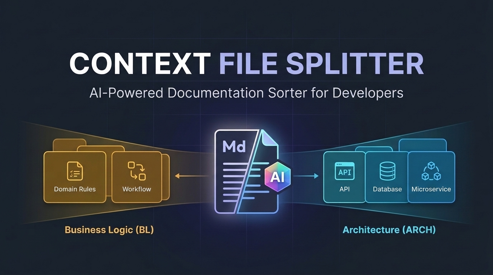
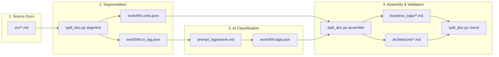

<div align="center">



# Context File Splitter

**AI-Powered Documentation Decomposer for Clean Separation of Business Logic and System Architecture**

[](plugin.json)
[](split_doc.py)
[](LICENSE)

</div>

---

## Overview

In real-world software projects, documentation and AI context files tend to mix **what the business requires** (pricing tiers, approval thresholds, domain invariants) with **how the system implements it** (REST endpoints, database schemas, Redis caches, Kafka topics).

**Context File Splitter** is an Antigravity plugin and CLI toolkit that automatically segments Markdown documentation, classifies every paragraph or code block using a deterministic domain-vs-technology decision rule, and assembles two clean, cross-referenced documentation trees:

- **`business_logic/`** — pure domain rules, workflows, roles, permissions, and invariants free of implementation noise.
- **`architecture/`** — technical contracts, APIs, data stores, infrastructure, and non-functional requirements.

---

## Business Value & Use Cases

| Stakeholder / Scenario | Problem with Monolithic Docs | How Context File Splitter Solves It |
| :--- | :--- | :--- |
| **Product Owners & Domain Experts** | Business rules are buried inside SQL schemas, HTTP status codes, and JSON payloads, making review slow and error-prone. | Generates a clean `business_logic/` tree containing only technology-agnostic domain specifications that stakeholders can audit directly. |
| **Software Architects & Developers** | Architectural constraints and API contracts are scattered across narrative product specs. | Extracts a dedicated `architecture/` tree with full traceability (`<!-- F01-U004 -->`) back to the source requirements. |
| **AI Coding Agents & LLM Context** | Feeding mixed documentation into an agent wastes context tokens and causes technology details to leak into domain models. | Provides targeted, high-signal context files—pass `business_logic/` when designing domain services and `architecture/` when building adapters or infrastructure. |
| **System Migrations & Rewrites** | Replacing a tech stack (e.g., REST to gRPC, PostgreSQL to Event Sourcing) requires untangling invariant business rules from legacy implementation details. | Applies the core test: *"Would this statement remain true after a complete change of technology?"*—preserving 100% of business invariants during migrations. |

---

## How It Works

The pipeline operates in four deterministic stages without ever modifying your original `src/*.md` files:



---

## Classification Model

Every non-heading block is evaluated against the **Technology Replacement Rule** defined in [`prompt_tagowanie.md`](prompt_tagowanie.md):

> **Decision Rule:** *Would the statement remain true after a complete change of technology?*
> - **Yes** → `BL` (Business Logic)
> - **No** → `ARCH` (Architecture)
> - **Partly yes, partly no** → `MIXED` (Split into technology-free `bl_text` and implementation-focused `arch_text`)

### Example Transformation (`MIXED` Unit)

**Source (`src/01_orders.md`):**
```markdown
## Approval Process

Orders above 1000 PLN require approval; endpoint POST /orders/{id}/approve returns 403 for other roles.
```

**Generated Business Logic (`business_logic/01_orders.md`):**
```markdown
## Approval Process

<!-- F01-U004 | see: architecture/01_orders.md -->
Orders above 1000 PLN require approval by an authorized role; other roles cannot approve them.
```

**Generated Architecture (`architecture/01_orders.md`):**
```markdown
## Approval Process

<!-- F01-U004 | see: business_logic/01_orders.md -->
Endpoint POST /orders/{id}/approve returns 403 for roles other than the authorized one.
```

---

## Technical Details

### 1. Structure-Aware Markdown Segmentation (`segment`)
- Parses headings (`#` through `######`) into a hierarchical stack (`Orders > Approval Process`) attached as `heading_path` metadata to every block, giving the classifier full structural context even for short paragraphs.
- Preserves fenced code blocks (` ``` ` and `~~~` of any length `>= 3`) intact as single atomic units so internal blank lines or `#` comments inside code are never misinterpreted as Markdown headings.
- Assigns deterministic, human-readable unit IDs (`F01-U001`, `F01-U002`, ...) across alphabetically sorted files.

### 2. Smart Heading Pruning & Cross-Referencing (`assemble`)
- Buffers section headings on a hierarchy stack (`pending_bl`, `pending_ar`) and **only emits headings that contain at least one classified block** (directly or in a nested subsection). Sections that are purely architectural never leave empty orphan headings in `business_logic/`, and vice versa.
- Injects HTML traceability comments (`<!-- F01-U002 -->`) and bidirectional cross-links (`<!-- F01-U004 | see: architecture/01_orders.md -->`) for `MIXED` units.

### 3. Automated Quality & Purity Gate (`check`)
- **Completeness Verification:** Ensures every block ID from `work/NN.units.json` is classified in `work/NN.tags.json`, uses a valid tag (`BL`, `ARCH`, `MIXED`), and is present in the assembled output files (requiring both `business_logic/` and `architecture/` entries for `MIXED` units).
- **Domain Purity Scanner:** Scans `business_logic/*.md` using split case-sensitive (`REST`, `API`, `GET`, `POST`, `PUT`, `DELETE`, `PATCH`, `SQL`, `JSON`, `HTTP/HTTPS`, `gRPC`) and case-insensitive (`GraphQL`, `endpoint*`, `Kafka`, `Redis`, `microservice*`, `Docker`, `Kubernetes`, `queue`, `schema`, `cache*`) regular expressions to guarantee no technical jargon leaked into business documentation.
- **Confidence Auditing:** Flags any unit with `confidence < 0.7` for human review and exits with a non-zero status code (`1`) if any validation problem is detected.

---

## Getting Started & Usage

### Prerequisites
- **Python 3.8+** (uses only the Python standard library—no third-party packages required).
- **Antigravity** (when running as an automated agent skill).

### Option A: Automated Execution via Antigravity Skill (Recommended)

1. In your target project root, place the Markdown documents you want to split inside the `src/` directory:
   ```text
   my-project/
   └── src/
       ├── 01_orders.md
       └── 02_payments.md
   ```
2. Invoke the **`context-file-splitter`** skill in Antigravity (defined in [`skills/context-file-splitter/SKILL.md`](skills/context-file-splitter/SKILL.md)).
3. The agent automatically runs segmentation, classifies all blocks according to [`prompt_tagowanie.md`](prompt_tagowanie.md), assembles `business_logic/` and `architecture/`, validates output purity with `check`, and reports a summary along with any low-confidence units.

### Option B: Manual CLI Execution

Run [`split_doc.py`](split_doc.py) from your target project root:

```sh
# 1. Segment src/*.md into work/NN.units.json and work/NN.to_tag.json
python3 /path/to/ContextFileSplitter/split_doc.py segment

# 2. Classify each work/NN.to_tag.json into work/NN.tags.json
#    following the schema and rules in prompt_tagowanie.md

# 3. Assemble business_logic/*.md and architecture/*.md
python3 /path/to/ContextFileSplitter/split_doc.py assemble

# 4. Validate completeness, MIXED links, and business logic purity
python3 /path/to/ContextFileSplitter/split_doc.py check
```

---

## Repository & Output Structure

```text
ContextFileSplitter/
├── assets/
│   └── banner.jpg                           # Repository hero graphic
├── skills/
│   └── context-file-splitter/
│       └── SKILL.md                         # Antigravity skill workflow instructions
├── plugin.json                              # Antigravity plugin manifest
├── prompt_tagowanie.md                      # Classification rules, schema & boundary examples
├── split_doc.py                             # Segmentation, assembly & validation CLI
├── README.md                                # Documentation
└── LICENSE                                  # Apache-2.0 License
```

When executed in a target project, the tool produces:

```text
target-project/
├── src/                  # Original Markdown files (read-only, never modified)
├── work/                 # Intermediate JSON artifacts (NN.units.json, NN.to_tag.json, NN.tags.json)
├── business_logic/       # Assembled technology-agnostic domain documentation
└── architecture/         # Assembled technical & architectural documentation
```

---

## License

Distributed under the **Apache License 2.0**. See [`LICENSE`](LICENSE) for full details.